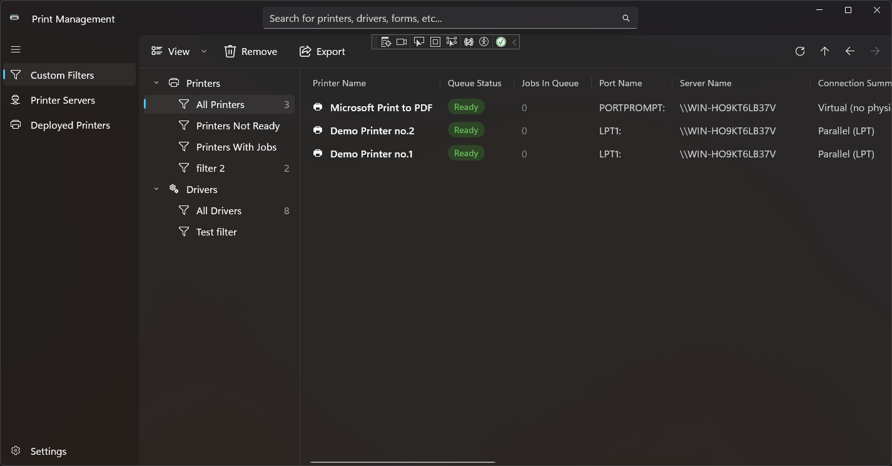

# Print Management on WinUI 3

The good old Print Management from the MMC toolset was rebuilt from the ground up using the latest WinUI 3 architecture, giving it a much needed fresh new look and overall better user experience.

This project is a passion project made solely out of the appreciation to the original program and the frustration of using printers we all know and love to hate

## What this program can and can not do

As of right now, this program can:

1. Show you your printers and drivers.
2. Manage filtering of printers and drivers
3. Has 4 different view mode
4. Allows you to export the list of printers and drivers to `.txt`, `.csv` following the original Print Management conventions, and providing additional support to `.md` export.
5. Technically (without being able to do that from the UI though) supports connection to remote servers, using the Windows Credential Manager to store user and password securely.
6. Full support for Windows 10 2002 (for those who dislikes Windows 11)

Things you can't do:

1. Following the above - edit the list of servers.
2. Remove printers and drivers.
3. Show list of forms and ports.
4. Have email notifications and running scripts when new items (e.g Printers) pass the filtration.
5. Managing anything about the printers, drivers, forms and ports.
6. A planned hub for filters is yet to be developed.

## Will it ever be "finished"?

As I work on this project on my free time, I can't tell. (Also there's no specific term for the word finish - I can take it as far as I wish...)

I may be able to vibe code it to the end, but my problem with that is that I care deeply for writing good software which I will enjoy using and maintaining, and for that I need to be involved.

Additionally, the more I am involved with the development of this software the farther I can take it (one example is the badges on the table which added following my work on fetching of the printers and drivers).

I will say that AI was used to make this software. We live at an age where the usage of AI is quit inevitable (especially me, who is coming from Web development and it's my first project in WinUI that I took this far), and yet I didn't want it to be only a copy-paste kind of development, so some of the code was hand crafted, like in the old days.
